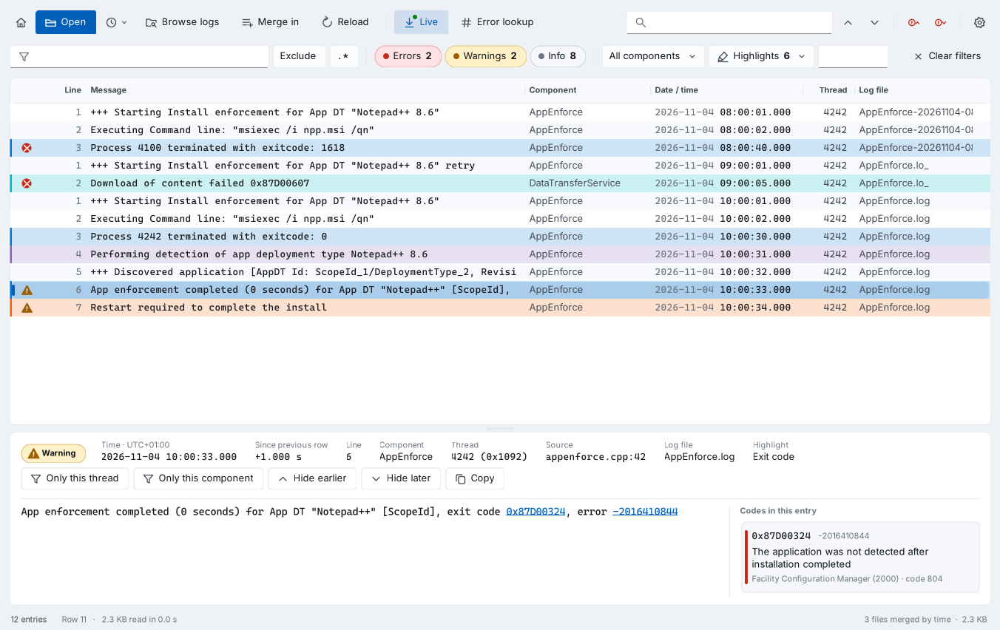
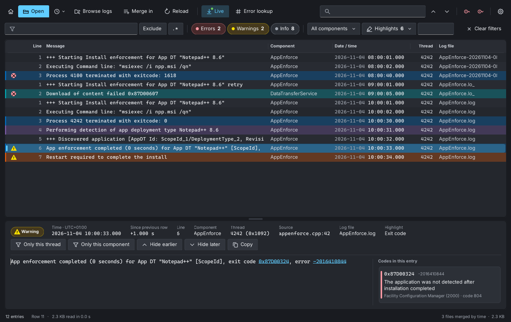
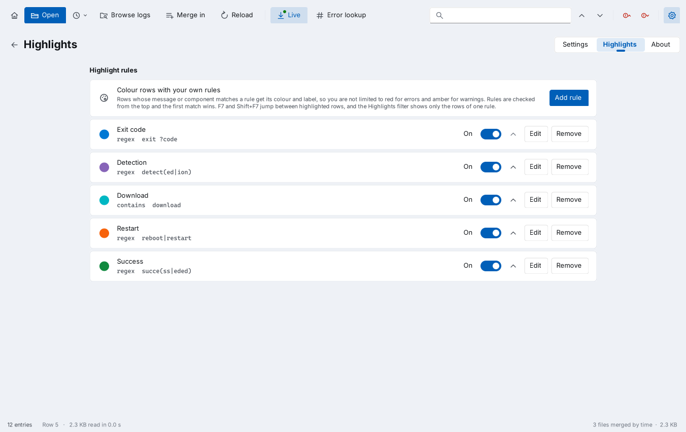

# Changelog

All versions of LogVice, newest first. LogVice was called Trace Lens up to version 1.3.2.

### At a glance

| Version | Highlights | Upgrade |
|---|---|---|
| **1.5.6** (latest) | Installing an update no longer hangs, with a window that shows each step | Run the MSI, or select Update in LogVice. It replaces Trace Lens and any earlier version |
| 1.5.6 | Installing an update no longer hangs: LogVice closes at once and an updater window shows each step |
| 1.5.5 | Follow an item: Intune Store apps, remediations, scripts and installed apps, several items at once, Windows events in the timeline | |
| 1.5.5 | Follow an item: Store apps, remediations, platform scripts and installed apps, several items at once, Windows events in the timeline |
| 1.5.4 | New app icon, and an icon of its own for log files | |
| 1.5.3 | What's new in the app, release notes in the Update dialog, winget manifests with every release | |
| 1.5.2 | Install updates from LogVice with one click, checked against the release checksums | |
| 1.5.1 | Faster loading, filtering and Follow an item, automatic tests | |
| 1.5.0 | Follow an item through every client log, update check with ADMX policy, releases built by GitHub Actions | |
| 1.4.0 | New name LogVice, Windows event logs (live channels, remote computers and .evtx files) | |
| 1.3.2 | Theme button in the toolbar, asks for administrator rights when a log needs them, more reliable Connect as | |
| 1.3.1 | Sharper, easier-to-read look: striped rows, colour bars, clearer timestamps, larger detail text | |
| 1.3.0 | Windows Update ETL logs, Home button, Connect as, auto-merge, linked error codes, highlight rules, line numbers | |
| 1.2.x | New logo, developer named, Browse logs with automatic log discovery, Settings and About | |
| 1.1.0 | Windows 11 style with light and dark themes | |

## LogVice 1.5.6

LogVice 1.5.6 makes installing an update from LogVice smooth: no more frozen window.

| | |
|---|---|
| Product code | `{3287F79C-BE69-4FF5-823D-564678B829C3}` |
| Upgrade code | `{2A8DF866-E6D4-4A44-ABAC-C64CA0D367B3}` (unchanged) |
| Files | `LogVice.msi`, `LogVice.exe`, `SHA256SUMS.txt` |

### Fixed in 1.5.6

- **Installing an update no longer hangs**: after **Install**, LogVice closes at once and a small **Updating LogVice** window shows each step: closing LogVice, installing, and starting it again.
    - If LogVice has not closed within 15 seconds, the updater closes it.
    - Other LogVice windows running from the same folder are closed too, so the installer never waits for a program that is still open.
- The status bar shows the download progress.
- When another installation is running, the update says so instead of ending with an error code.

The update is carried out by the version you are running, so this applies to updates you start from 1.5.6. If 1.5.5 stops responding after **Install**, close it and the update continues.

## LogVice 1.5.5

LogVice 1.5.5 makes Follow an item broader: more kinds of items, several at once, and the Windows events that go with them.

| | |
|---|---|
| Product code | `{BC1C2600-3FA3-4AA7-8AF7-576F60674AB7}` |
| Upgrade code | `{2A8DF866-E6D4-4A44-ABAC-C64CA0D367B3}` (unchanged) |
| Files | `LogVice.msi`, `LogVice.exe`, `SHA256SUMS.txt` |

### New in 1.5.5

- **More to follow from Intune**: Follow an item now lists Store apps, remediations and platform scripts from the Intune Management Extension logs, next to Win32 apps.
    - Win32 apps bring their MSI product code from the detection rule, so detection and Windows Installer lines are found too.
    - Store apps bring their package identifier, so the WinGet lines in `AgentExecutor.log` are found too.
    - Remediations show their last result and detection output. Intune does not write their names to the device, so remediations and platform scripts are listed by policy ID.
- **Installed apps**: every app in Apps & features can be followed, with its MSI product code when it has one. An app that Intune deploys is shown once, on the Intune app, with its installed version. On another computer the list is read through WMI.
- **Several items at once**: hold Ctrl or Shift to pick more than one, for example an app and its dependency, and follow them in one timeline.
- **Windows events in the timeline**: with **Also search Windows events** on, Follow an item also looks through Application, System, the MDM diagnostics log, AppX deployment and Windows Update, and adds the event logs with matches to the timeline.
- On a computer without the ConfigMgr client, the dialog now says so, instead of showing a WMI error.

## LogVice 1.5.4

LogVice 1.5.4 has a new icon, and log files get an icon of their own.

| | |
|---|---|
| Product code | `{A9263E20-7EF1-4668-898D-60331A11E33D}` |
| Upgrade code | `{2A8DF866-E6D4-4A44-ABAC-C64CA0D367B3}` (unchanged) |
| Files | `LogVice.msi`, `LogVice.exe`, `SHA256SUMS.txt` |

### New in 1.5.4

- **New app icon**: the lines of a log under a magnifier, in neon cyan and pink on navy. It replaces the synthwave sun on `LogVice.exe`, in the Start menu, on the taskbar, on the start page and in About.
- **An icon for log files**: with the MSI, `.log`, `.lo_`, `.etl` and `.evtx` files that open with LogVice show a document with the same magnifier, so log files and the app are easy to tell apart in File Explorer.
- Both icons are drawn as vector shapes with heavier lines at 16 to 24 pixels, so they stay sharp in the Details view and at every display scale. The sources are in the `art` folder.
- After an update LogVice asks Windows to refresh file icons. If File Explorer still shows the old icon, sign out and in again.

## LogVice 1.5.3

LogVice 1.5.3 tells you what changed, right in the app, and every release now comes with manifests for winget.

| | |
|---|---|
| Product code | `{E356B345-5FFA-47BF-BCBE-EE9668F28AB1}` |
| Upgrade code | `{2A8DF866-E6D4-4A44-ABAC-C64CA0D367B3}` (unchanged) |
| Files | `LogVice.msi`, `LogVice.exe`, `SHA256SUMS.txt` |

### New in 1.5.3

- **What's new**: after LogVice has been updated, a bar under the toolbar says so. Select **What's new** to read everything that changed since the version you had. The notes are built into LogVice, so they also work offline and when the update check is turned off by policy.
- **About > What's new** lists every version, newest first.
- **Release notes before you install**: the **Update** dialog shows the new version's release notes from GitHub, with **Install**, **Release page** and **Not now**.
- **winget**: the build workflow writes winget manifests for every release, checked against the MSI it just built, and submits them to the Windows Package Manager community repository. Once the package is approved, `winget install DanielBaldissera.LogVice` installs LogVice and `winget upgrade` keeps it up to date.

## LogVice 1.5.2

LogVice 1.5.2 installs a new version for you. When the update check finds one, select **Update** and LogVice downloads it, checks it and installs it.

| | |
|---|---|
| Product code | `{4050591A-C0F1-4E84-894A-B8D08AA798B6}` |
| Upgrade code | `{2A8DF866-E6D4-4A44-ABAC-C64CA0D367B3}` (unchanged) |
| Files | `LogVice.msi`, `LogVice.exe`, `SHA256SUMS.txt` |

### New in 1.5.2

- **Install updates from LogVice**: the **Update** button in the toolbar and **Install** in About download the new version from this repository's GitHub release and check it against the release's `SHA256SUMS.txt`. A file that does not match is deleted and never run.
  - Installed with the MSI: LogVice closes, runs the new MSI with a progress bar and asks for administrator rights (UAC). The upgrade replaces the old version in place.
  - Portable exe: LogVice closes and replaces its own `LogVice.exe` with the new one. No administrator rights are needed when you can write to the folder.
  - Afterwards LogVice opens again with the logs you had open.
- **No surprises**: nothing is downloaded until you select **Install**, and you can choose **No** to read the release notes instead. A release without `SHA256SUMS.txt` is only offered as a download.
- Downloads use the Windows proxy settings. The download and the installer log are kept in `%TEMP%\LogVice-update-<version>` and removed the next time LogVice starts.

Update to 1.5.2 by hand once. From 1.5.2 on, later versions install with the **Update** button.

## LogVice 1.5.1

LogVice 1.5.1 loads, filters and follows items faster, and every build is now tested automatically.

| | |
|---|---|
| Product code | `{6F8A9909-3D0A-40F6-9C43-8E3FA7DD7BFD}` |
| Upgrade code | `{2A8DF866-E6D4-4A44-ABAC-C64CA0D367B3}` (unchanged) |
| Files | `LogVice.msi`, `LogVice.exe`, `SHA256SUMS.txt` |

### Improved in 1.5.1

- **Faster loading**: CMTrace logs are parsed without temporary strings for the time, date, type, thread, component and file fields, which makes large logs load about 15 to 20 percent faster.
- **Several logs at once**: when you open or merge several logs, they are read in parallel, one per processor core, which helps most with many logs and with logs on another computer.
- **Filters, Find and highlight rules** run across all processor cores.
- **Follow an item** searches each log once per ID, in parallel, and is about 5 times faster.
- **Less memory**: spare memory is released after a log has loaded.
- **Tests**: every build runs parser, merge and Follow an item tests on small synthetic logs, so a change in how a log is read is caught before release.

## LogVice 1.5.0

LogVice 1.5.0 follows one application, update, package or baseline through every ConfigMgr client log, tells you when a newer version is out, and is now built by GitHub Actions with checksums and a provenance attestation.

| | |
|---|---|
| Product code | `{902113B3-B6C9-45F4-8F0D-EB8CC84629A5}` |
| Upgrade code | `{2A8DF866-E6D4-4A44-ABAC-C64CA0D367B3}` (unchanged) |
| Files | `LogVice.msi`, `LogVice.exe`, `SHA256SUMS.txt` |

### New in 1.5.0

- **Follow an item** (Ctrl+I, the start page or Browse logs): pick an application, deployment type, software update, package, configuration baseline or Intune Win32 app. LogVice reads them from the ConfigMgr client's WMI and from the logs, collects the item's IDs, searches every client and Intune Management Extension log, follows content and download job IDs it finds on the way, and opens the matching logs merged by time and filtered to that item. Works on this computer and on a computer you connect to in Browse logs. Thanks to [u/overlydelicioustea](https://www.reddit.com/user/overlydelicioustea/) on r/SCCM for the idea and for describing how it could work: collect every reference to one item, search all client logs for them, and put the result in one timeline.
- **Update check**: once a day at start, LogVice asks GitHub for the latest release. When there is a newer one, an **Update** button appears in the toolbar and About shows a **Download** button. Nothing about you or your logs is sent, and the Windows proxy settings are used.
- **Settings > Updates** turns the check on or off, and **About > Updates** has **Check now**.
- **Policy**: `DisableUpdateCheck = 1` (DWORD) under `HKLM\SOFTWARE\Policies\LogVice` turns the check off for everyone. An administrative template for Intune and Group Policy is in `policy/`.
- **Builds by GitHub Actions**: releases are built from the source in the repository, with `SHA256SUMS.txt` and a build provenance attestation you can check with `gh attestation verify`.
- **Fixed product code per version**: the product code is set in `LogVice.wxs`, so it is known before the build and stays the same if a release is rebuilt.

## LogVice 1.4.0

LogVice 1.4.0 gives Trace Lens a new name and adds Windows event logs.

| | |
|---|---|
| Product code | `{2BDC8F66-2461-46EE-AA50-3264BCC5F34A}` |
| Upgrade code | `{2A8DF866-E6D4-4A44-ABAC-C64CA0D367B3}` (unchanged) |
| Files | `LogVice.msi`, `LogVice.exe` |

### New name

- **Trace Lens is now LogVice.** The app works as before. The files are now `LogVice.exe` and `LogVice.msi`, and the MSI installs to `C:\Program Files\LogVice`.
- **Upgrade in place.** The MSI has the same upgrade code, so it removes Trace Lens and installs LogVice, with the Start menu shortcut and *Open with* moved to the new name.
- **Your settings come along.** On first start, LogVice copies your settings, highlight rules, folders and recent logs from `HKCU\Software\Trace Lens` to `HKCU\Software\LogVice`.

### New in 1.4.0

- **Windows event logs**: open exported `.evtx` files with Open, drag and drop or *Open with*, or read live channels.
- **Event logs in Browse logs**: the new Event logs group lists *Common event logs* (Application, System, Security, Setup, Intune MDM, Entra, device registration, Autopilot, provisioning, Windows Update, BITS, Group Policy, BitLocker, Defender, AppLocker, Code Integrity, AppX deployment, PowerShell, Task Scheduler, WMI and WinRM) and *All event logs* (every channel that has events). The folder button opens Event Viewer.
- **Event logs on other computers**: Connect and Connect as in Browse logs also list the event logs of that computer. It needs the firewall rule group *Remote Event Log Management* on that computer.
- **Events read like log lines**: the message shows `[Event ID]` and the event text, Critical and Error events are errors, Warning and audit failure events are warnings, the provider is the component, and the record ID is in the Line column. The detail pane shows the event ID and task category under Source.
- **Merge across sources**: open an event log together with log files, for example `IntuneManagementExtension.log` with the DeviceManagement-Enterprise-Diagnostics-Provider Admin log, and read them as one timeline.
- **Live view** follows event log channels on this computer.
- **Command line**: `evt:<channel>` and `evt:\\<computer>\<channel>` open channels, for example `LogVice.exe evt:System`.
- **Administrator prompt**: channels that need administrator rights, such as Security, offer to restart LogVice as administrator.

### Known limitations in 1.4.0

- Event log channels on another computer are not followed live. Press F5 to read new events.
- An `.evtx` file from another computer is shown with the event texts installed on this computer. Events from a provider that is not installed here show their values instead of the full text.

## Trace Lens 1.3.2

Trace Lens 1.3.2 adds a theme button, asks for administrator rights when a log needs them, and makes Connect as easier to use and more reliable.

### New in 1.3.2

- **Theme button**: the moon next to the gear switches to the dark theme, and the sun switches back to light. System is still under Settings > Appearance.
- **Administrator rights when needed**: when a file cannot be read without administrator rights, Trace Lens lists it and asks whether to restart as administrator. After the UAC prompt it opens the same logs again. Folders you cannot read show *Needs administrator rights* in Browse logs, with a **Restart as administrator** button. Settings > Opening logs has the same button, and the title bar shows *Administrator:* while elevated. The PowerShell script restarts itself the same way.
- **For the curious**: Trace Lens has picked up a taste for pastel suits and neon. You will know it when you type it.

### Fixed in 1.3.2

- **Connect as** did nothing visible when no computer name was typed. It now explains what to do, and offers to restart as administrator for logs on this computer.
- **Connect as** failed with *already connected with another account* after you had first selected Connect with your own account. Trace Lens now tries the computer's full DNS name, short name and IP address by itself.
- Sign-in errors now open a message instead of only showing a line of text in the folder list. The message explains Remote UAC when a local account is accepted but cannot read the admin shares.
- The sign-in dialog's password is now read correctly when Windows returns it in protected form.
- **Connect as** keeps its label in a narrow window, and Ctrl+Enter in the computer name box selects it.
- The start page now fills the whole window right after you return to it.

## Trace Lens 1.3.1

Trace Lens 1.3.1 gives Trace Lens a sharper Windows 11 and Windows Server 2025 look that is easier to read in long sessions. Features and settings work exactly as in 1.3.0.

- **Striped rows**: every other row has a faint stripe, so your eye stays on the line across wide logs.
- **Colour bars**: errors and warnings get a red or amber bar at the left edge as well as the tint. Highlight rules show their own colour there.
- **Clearer timestamps**: the date is dimmed and the time is bright, because the time is what changes from row to row.
- **More room**: Standard row spacing is a little taller, and the detail pane shows the message in a slightly larger font.
- **Higher contrast**: secondary text is darker in light mode and brighter in dark mode, and cards stand out more from the window background.
- **New start page**: a larger title with the version, a soft accent glow and coloured icon tiles for each log folder: blue for ConfigMgr, teal for Intune, purple for Windows and orange for your own folders.

*The dark theme with highlight rules, line numbers and a linked error code.*

## Trace Lens 1.3.0

Trace Lens 1.3.0 reads Windows Update ETL logs, lets you connect to other computers with another account, and adds your own highlight colours, line numbers, a Home button and clickable error codes. The MSI upgrades every earlier version in place.

### New in 1.3.0

- **Windows Update ETL logs**: open `WindowsUpdate.*.etl` from `C:\Windows\Logs\WindowsUpdate` directly, without `Get-WindowsUpdateLog`. Each event shows its time, thread, component and message. Browse logs lists the folder on this and remote computers, together with `ReportingEvents.log`. Other ETL files open too when Windows can decode them.
- **Home button**: the house at the far left of the toolbar (Alt+Home) shows the start page while your logs stay open. **Back to** *file name*, Esc or Home again returns to them.
- **Connect as**: in Browse logs, connect to a server or client with another account through the Windows sign-in dialog, with no Run as and no extra session. The account is used for that computer only. **Remember my credentials** keeps it in Windows Credential Manager.
- **Auto-merge spanned logs**: opening one part of a split log also merges the others by time: `X.lo_`, dated copies such as `AppEnforce-20261104-101500.log`, `CbsPersist_*.log` next to `CBS.log` and every `WindowsUpdate.*.etl`. On by default under Settings > Opening logs, and switchable in Browse logs.
- **Error codes as links**: codes in the detail pane message are underlined. Select one, or a card under *Codes in this entry*, to open Error lookup with it.
- **Highlights**: your own rules with a label, a text or regex match and a colour, under the new Settings > Highlights tab. Matching rows get the rule's colour. The **Highlights** filter shows the rows of one rule, F7 and Shift+F7 jump between them, and right-click > **Highlight** *component* starts a rule from a row. **Add examples** gives five ready-made rules.
- **Line numbers**: a Line column with the line where each entry starts in its file, or the event number for ETL. **Ctrl+G** goes to a line. The detail pane shows it too.

*Highlight rules in Settings > Highlights.*

### Improvements in 1.3.0

- The Open dialog also lists `.etl` files, and the MSI adds Trace Lens to Open with for `.etl`.
- Recent files remember the file you opened, so reopening it picks up parts written since.
- The detail pane shows the highlight label of the selected row.
- Settings has three tabs: Settings, Highlights and About. Keyboard shortcuts in About include the new keys.

## Trace Lens 1.2.2

Trace Lens 1.2.2 gives Trace Lens a new 1980s-style logo: a synthwave sun setting over a neon grid. Logs open, read and filter exactly as in 1.2.1, and the MSI upgrades every earlier version in place.

- **New logo**: on the exe and MSI icon, in the title bar and taskbar, on the start page and in About. Each icon size from 16 px to 256 px is drawn for its size, so the logo stays sharp in Explorer, the Start menu and Programs and Features.
- **Logo for app catalogs**: `TraceLens-logo-512.png`, a 512 × 512 px PNG, comes with the release for the app icon in Intune, the Company Portal and Software Center.

## Trace Lens 1.2.1

Trace Lens 1.2.1 fixes an error after changing the log text size and names the developer in About. Everyone on 1.2.0 should upgrade.

- **Fixed**: changing **Log text size** in Settings and going back to the log view showed an error message, and parts of the toolbar stopped drawing.
- **Developer and publisher**: About shows "Developed by Daniel L. Baldissera". The exe and the MSI now name Daniel L. Baldissera as company and publisher, so Programs and Features shows him as the publisher.
- **Magic numbers**: Error lookup recognises a few well-known magic numbers, such as `0xDEADBEEF`, `0xBAADF00D` and `0xCAFEBABE`, and says that they are not Windows errors.
- **For the curious**: something new is hidden in Trace Lens.

## Trace Lens 1.2.0

Trace Lens 1.2.0 finds ConfigMgr, Intune and Windows logs for you, on this computer or another one, and adds a Settings and About page. The MSI upgrades 1.0.0 and 1.1.0 in place.

### New in 1.2.0

- **Browse logs** (Ctrl+B): a built-in log browser with the log folders on the left and their files on the right, newest first. You can filter by name, sort, pick several files and open or merge them.
- **Automatic log discovery**: finds the ConfigMgr site server logs (from the registry or the default install folder), plus management point, distribution point, site setup, console, client, client setup, task sequence and software update point logs. It also finds Intune Management Extension logs and Windows servicing, setup, debug and Temp installer logs.
- **Log folders on the start page**: each folder found is shown as a card with its number of logs and when it was last written.
- **Another computer**: type a name in Browse logs and select Connect. Trace Lens finds the same logs through the admin shares and the `SMS_<site code>` and `SMS_DP$` shares.
- **Rolled-over history**: opening `X.log` from Browse logs also opens `X.lo_` and merges them by time. This is on by default.
- **Active files**: a green dot marks logs written in the last 10 minutes.
- **Settings** (Ctrl+,): theme (System, Light, Dark), log text size, row spacing, row tint, Live at start, rolled-over history, reopen the last logs, your own log folders, clear recent files and reset.
- **About**: version, build date, .NET Framework, Windows, process, program and settings locations, with **Copy details** for support tickets, plus supported formats and keyboard shortcuts.
- **System theme**: with Theme set to System, Trace Lens switches when Windows switches between light and dark.

### Improvements in 1.2.0

- The theme button in the toolbar is replaced by the Settings button. The theme is now under Settings > Appearance.
- The Date / time and Thread columns size themselves to the log text size.
- Folder shortcuts on the start page are replaced by the discovered log folders.

## Trace Lens 1.1.0

Trace Lens 1.1.0 brings a redesigned interface in the Windows 11 and Windows Server 2025 style, with light and dark themes. It also speeds up everyday log work with a start page, recent files, right-click actions on rows and keyboard jumps between errors.

Reading, filtering, merging, live tail and error lookup work as in 1.0.0. Logs open the same way, and the MSI upgrades 1.0.0 in place.

### New in 1.1.0

- **Fluent design**: rounded cards, new line icons, and Segoe UI Variable and Cascadia Mono where Windows has them.
- **Light and dark themes**: follow the Windows app mode at first start. Switch with the moon or sun button. On Windows 11 and Server 2025 the title bar matches the theme.
- **Start page**: Open logs, shortcuts to the ConfigMgr, Intune Management Extension and Windows log folders, and recent files.
- **Recent files**: the last ten files or merged sets, from the start page or the clock button next to Open.
- **Drop zones**: dragging files over the window offers Open or Merge in.
- **New log list**: severity icons, tinted error and warning rows, resizable columns, range selection with Shift+click or drag, Ctrl+A, and a slim scrollbar.
- **Right-click menu on rows**: copy rows or only the message text, show only this thread or component, hide earlier or later rows, look up the first error code, and clear filters.
- **Error navigation**: F8 and Shift+F8 jump to the next and previous error.
- **Merge shortcut**: Ctrl+Shift+O merges more files into the open view.
- **Find position**: the search box shows where you are, for example 18 / 2,215.
- **Code cards**: failure codes get a red bar and success codes (0, 3010, 1641) a green one.
- **Live indicator**: the Live button flashes when new lines arrive.
- **Remembered window**: size, position and theme are kept between sessions.

### Improvements in 1.1.0

- Find highlights the matching text inside each row, instead of making the whole row bold.
- The message pane shows a scrollbar only when the text needs one.
- In a narrow window, toolbar labels collapse to icons and the severity filters to their counts.
- Loading shows a progress card in the list and a progress line in the status bar.
- The detail pane lays out time, delta, component, thread, source and log file as labelled fields that wrap.
- File name, size, format and encoding moved to the status bar.

## Install and upgrade

LogVice needs Windows 10, Windows 11 or Windows Server 2016 or later. It runs on the .NET Framework that comes with Windows: 4.8 or 4.8.1, or 4.6.2 on Windows Server 2016.

| Package | How to upgrade from an earlier version |
| --- | --- |
| LogVice.msi | Run the 1.5.6 MSI. It replaces Trace Lens or an earlier LogVice in place, with no uninstall needed |
| LogVice.exe (portable) | Delete TraceLens.exe and use LogVice.exe. Your settings are copied on first start |

| MSI setting | Value |
| --- | --- |
| Install command | `msiexec /i LogVice.msi /qn` |
| Uninstall command | `msiexec /x {3287F79C-BE69-4FF5-823D-564678B829C3} /qn` |
| Product code (1.5.6) | `{3287F79C-BE69-4FF5-823D-564678B829C3}` |
| Product code (1.5.5) | `{BC1C2600-3FA3-4AA7-8AF7-576F60674AB7}` |
| Product code (1.5.4) | `{A9263E20-7EF1-4668-898D-60331A11E33D}` |
| Product code (1.5.3) | `{E356B345-5FFA-47BF-BCBE-EE9668F28AB1}` |
| Product code (1.5.2) | `{4050591A-C0F1-4E84-894A-B8D08AA798B6}` |
| Product code (1.5.1) | `{6F8A9909-3D0A-40F6-9C43-8E3FA7DD7BFD}` |
| Product code (1.5.0) | `{902113B3-B6C9-45F4-8F0D-EB8CC84629A5}` |
| Product code (1.4.0) | `{2BDC8F66-2461-46EE-AA50-3264BCC5F34A}` |
| Product code (1.3.2) | `{77F03080-EDFC-44B9-B5E7-BE515EA07AEE}` |
| Product code (1.3.1) | `{4CFC072C-7DFE-495D-83AF-FDC1AE6C5ADC}` |
| Product code (1.3.0) | `{BBB6D56A-70EA-4204-BE06-B39B1FCDAB9A}` |
| Product code (1.2.2) | `{1AEEEE9B-99DD-42C2-B89D-C6721D4AA191}` |
| Product code (1.2.1) | `{AD33FC84-7300-4A04-9843-26F4B612369E}` |
| Product code (1.2.0) | `{BB0FE663-359D-47D1-B304-0FC63FAF5447}` |
| Product code (1.1.0) | `{31C5B03F-FBA5-4C65-9FBF-B4035CF890E0}` |
| Upgrade code (all versions) | `{2A8DF866-E6D4-4A44-ABAC-C64CA0D367B3}` |
| Publisher | Daniel L. Baldissera (from 1.2.1) |
| Install context | System, per machine |
| Restart | Not needed |

In Intune or ConfigMgr, add 1.5.6 as a new app that supersedes the earlier version and detects the new product code. Devices then upgrade without an uninstall step.

## Known limitations

- The exe and MSI are unsigned. SmartScreen warns on downloaded copies, and AppLocker or WDAC need them signed with your own certificate.
- Browsing another computer needs an administrator account on it and file sharing (SMB) to it. LogVice does not read that computer's registry, so ConfigMgr installed outside the default folder is found only through its `SMS_<site code>` share.
- Merging sorts by the local time written in each log, so logs from computers in different time zones can interleave out of order.
- Logs are held in memory, about two to three times their size on disk.
- Live tail checks the files once a second. It stops updating while a remote computer or share is offline.
- On Windows 10 and Server 2016 to 2022 the title bar keeps the system colours, and the interface uses Segoe UI and Consolas.
- Windows Update traces from Windows Server 2016 and Windows 10 1607 and earlier need Microsoft symbol files and cannot be decoded. LogVice says so. Run `Get-WindowsUpdateLog` and open the `WindowsUpdate.log` it writes instead.
- ETL files are read once and are not followed by Live. Select Reload to read them again.
- Event log channels on another computer are not followed by Live. Select Reload to read new events. Reading them needs the firewall rule group Remote Event Log Management on that computer.
- An .evtx file from another computer is shown with the event texts installed on this computer. Events from a provider that is not installed here show their values instead of the full text.
- Connect as uses one account per computer name. If you already have a mapped drive to that computer with another account, use its full DNS name or IP address.

## Version history

| Version | Summary |
| --- | --- |
| 1.5.4 | New app icon, an icon of its own for log files, icons drawn as vectors |
| 1.5.3 | What's new bar after an update, About > What's new, release notes in the Update dialog, winget manifests |
| 1.5.2 | Install updates from LogVice: download from GitHub, check against SHA256SUMS.txt, install and reopen |
| 1.5.1 | Faster loading, parallel reading of several logs, parallel filters and Find, Follow an item about 5 times faster, automatic tests |
| 1.5.0 | Follow an item through every client log; update check with Update button and ADMX policy; releases built by GitHub Actions |
| 1.4.0 | New name LogVice (was Trace Lens); Windows event logs: live channels, remote computers and .evtx files; settings carried over |
| 1.3.2 | Theme button, administrator prompt for protected logs, Connect as fixes, a new secret |
| 1.3.1 | Sharper, easier-to-read look: striped rows, colour bars, clearer timestamps, larger detail text, new start page |
| 1.3.0 | Windows Update ETL logs, Home button, Connect as, auto-merge of spanned logs, error codes as links, highlight rules and line numbers |
| 1.2.2 | New 1980s synthwave logo on the icon, window, start page and About; 512 px PNG for app catalogs |
| 1.2.1 | Fix for changing the log text size; developer and publisher named; magic numbers in Error lookup |
| 1.2.0 | Browse logs with automatic ConfigMgr, Intune and Windows log discovery, on this or another computer; Settings and About |
| 1.1.0 | Fluent redesign with light and dark themes, start page, recent files, drop zones, right-click actions and F8 error navigation |
| 1.0.0 | First release: CMTrace, SMS trace, CBS and plain text logs, background loading, merge by time, filters, find, live tail, error lookup, and the portable exe, MSI and PowerShell script |
