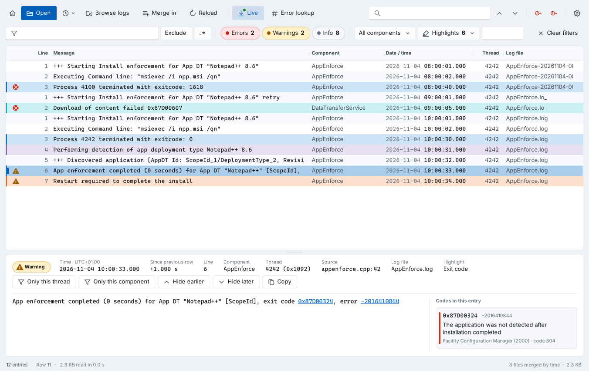
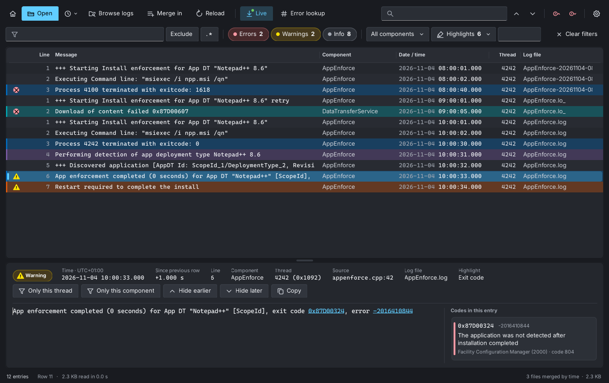
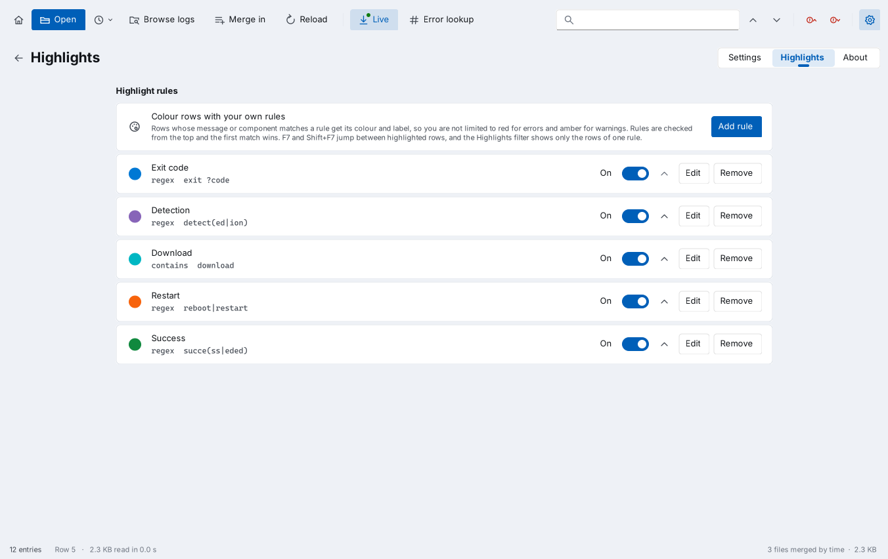

<p align="center">
  
</p>

<h1 align="center">LogVice</h1>

<p align="center">
  A fast, modern CMTrace-style log viewer for ConfigMgr, Intune, Windows logs and Windows event logs.
</p>

<p align="center">
  
  <a href="../../actions/workflows/build.yml"></a>
  
  
  
  <a href="LICENSE"></a>
</p>



LogVice opens the logs you read every day as an endpoint admin: ConfigMgr client and site server logs, Intune Management Extension logs, CBS, DISM and Panther logs, Windows Update ETL traces and Windows event logs. It reads large files in the background, merges several logs by time, follows them as they are written, and explains error codes, in a Windows 11 style window with light and dark themes.

It is one small exe with no installer requirement and nothing to configure. An MSI is available too. Free and open source under the MIT license.

> LogVice was called Trace Lens up to version 1.3.2. The MSI upgrades an installed Trace Lens, and your settings come along.

## Features

- **Large files, fast.** Logs are read in the background and only the visible rows are drawn, so a 500 MB log opens without freezing the window.
- **All the usual formats.** CMTrace (ConfigMgr and Intune IME), SMS trace, CBS, DISM and Panther, Windows Update ETL traces, and any plain text log with timestamps. UTF-8, UTF-16 and ANSI are detected.
- **Windows event logs.** Open exported `.evtx` files, or read live channels such as Application, System, Security, Intune MDM (DeviceManagement-Enterprise-Diagnostics-Provider), Entra, Autopilot and Windows Update, on this computer or another one. Errors and warnings are marked like in CMTrace.
- **Follow an item.** Pick an application, deployment type, software update, package or configuration baseline from the ConfigMgr client, an Intune Win32 or Store app, a remediation, a platform script or any installed app, and LogVice shows every line about it from every client log and the related Windows events in one timeline: policy, discovery, content download, install and detection. Pick several to see them together.
- **One timeline across sources.** Merge an Intune IME log with the MDM event log, or AppEnforce.log with the Application log, and read them by time.
- **Browse logs.** Finds ConfigMgr site server, management point, distribution point, console, client, client setup and task sequence logs, Intune Management Extension logs, Windows logs and event logs for you, on this computer or another one.
- **Connect as.** Read logs on a server with your admin account, without Run as or a second session.
- **Merge by time.** Open several logs and read them as one timeline. Auto-merge adds the rolled-over parts of a log (`.lo_`, dated copies, `CbsPersist_*`, `WindowsUpdate.*.etl`) by itself.
- **Live tail.** Follow logs and local event log channels while they are written, including rollover.
- **Filters and find.** Filter by text or regex, severity, component, thread and time. Find with F3, jump between errors with F8.
- **Highlights.** Your own rules with a label, a match and a colour, for example *Detection*, *Download* or *Exit code*. Filter by rule and jump between them with F7.
- **Error lookup.** HRESULT, Win32, MSI, Windows Update and ConfigMgr codes are explained in the detail pane. Codes in a message are links.
- **Line numbers.** See where each entry is in the file, or the record ID of an event, and press Ctrl+G to go to it.
- **Administrator rights only when needed.** LogVice runs as a normal user and offers to restart as administrator when a log needs it, such as the Security event log.
- **Read-only and private.** Files are opened read-only with full sharing, so clients keep writing and rolling them. Nothing about you or your logs leaves the computer.
- **Updates.** Once a day LogVice asks GitHub for the latest version. When there is a newer one, select **Update** and LogVice downloads it, checks it against the release's checksums, installs it and opens again with your logs. Afterwards **What's new** shows what changed. Turn the check off in Settings, or for everyone with a policy.

<table>
  <tr>
    <td></td>
    <td></td>
  </tr>
  <tr>
    <td align="center">Dark theme</td>
    <td align="center">Highlight rules</td>
  </tr>
</table>

## Download

Get the latest version from [Releases](../../releases). Pick the package that suits you:

| Package | Use it when |
|---|---|
| `LogVice.msi` | You deploy to many devices with Intune or ConfigMgr. Installs per machine, adds a Start menu shortcut and *Open with* for `.log`, `.lo_`, `.etl` and `.evtx`, with an icon of its own for those files |
| `LogVice.exe` | You want a portable tool on a USB stick, a share or a jump server. No install needed |
| `SHA256SUMS.txt` | Checksums of the exe and MSI, to check a download |

Every release is built by [GitHub Actions](../../actions/workflows/build.yml) from the source in this repository, not on a private PC. Check that a file you downloaded is exactly what GitHub built:

```powershell
Get-FileHash .\LogVice.msi -Algorithm SHA256     # compare with SHA256SUMS.txt
gh attestation verify .\LogVice.msi -R Baldissera88/LogVice
```

### Requirements

- Windows 10, Windows 11 or Windows Server 2016 or later
- .NET Framework 4.8 or 4.8.1, which is part of every supported Windows version and supported for as long as Windows is. Nothing extra to install
- Windows Server 2016 with its built-in .NET Framework 4.6.2 also works

LogVice is compiled against the .NET Framework 4.5 API so the same exe runs on every .NET Framework 4.x a machine has. It does not need, or install, the retired 4.5 runtime.

## Deploy with Intune or ConfigMgr

The MSI installs per machine, needs no restart and upgrades any earlier version in place, Trace Lens included.

| Setting | Value |
|---|---|
| Install command | `msiexec /i LogVice.msi /qn` |
| Uninstall command | `msiexec /x {3287F79C-BE69-4FF5-823D-564678B829C3} /qn` |
| Detection | MSI product code `{3287F79C-BE69-4FF5-823D-564678B829C3}` (version 1.5.6) |
| Upgrade code | `{2A8DF866-E6D4-4A44-ABAC-C64CA0D367B3}` (the same for every version) |
| Install context | System |

Each new version has a new product code, listed in the [changelog](CHANGELOG.md) and in the release notes. Add it as a new app that supersedes the earlier one.

On managed devices, users without administrator rights cannot install the MSI from the **Update** button, so deploy new versions with Intune or ConfigMgr and turn off the update check. Use the administrative template in [`policy/`](policy): import `LogVice.admx` and `en-US/LogVice.adml` in Intune under **Devices > Configuration > Import ADMX**, or copy them to the Group Policy central store, then enable **LogVice > Turn off the update check**. This also hides the **Update** button. The policy sets this value:

| Key | Value | Type | Data |
|---|---|---|---|
| `HKLM\SOFTWARE\Policies\LogVice` | `DisableUpdateCheck` | DWORD | `1` |

## Usage

```powershell
# Open one log
LogVice.exe C:\Windows\CCM\Logs\AppEnforce.log

# Open several logs merged by time
LogVice.exe C:\Windows\CCM\Logs\AppDiscovery.log C:\Windows\CCM\Logs\AppEnforce.log

# Wildcards and remote computers work too
LogVice.exe \\PC0123\C$\Windows\CCM\Logs\CcmExec*.lo*

# Event logs: an exported file, a channel here, or a channel on another computer
LogVice.exe C:\Temp\System.evtx
LogVice.exe evt:Application "evt:Microsoft-Windows-DeviceManagement-Enterprise-Diagnostics-Provider/Admin"
LogVice.exe evt:\\PC0123\System

# Merge a log file with an event log
LogVice.exe C:\ProgramData\Microsoft\IntuneManagementExtension\Logs\IntuneManagementExtension.log "evt:Microsoft-Windows-DeviceManagement-Enterprise-Diagnostics-Provider/Admin"
```

You can also drag files onto the window. Hold Ctrl while dropping to merge them into what is open.

### Follow an item

Press **Ctrl+I**, or select **Follow an item** on the start page or in Browse logs.

1. LogVice lists what it can follow:
    - from the ConfigMgr client's WMI: applications, software updates, packages and programs, and configuration baselines
    - from the client logs: deployment types, updates and programs
    - from the Intune Management Extension logs: Win32 apps with their MSI product code, Store apps with their package identifier, remediations with their last result and output, and platform scripts
    - from Apps & features: every installed app, with its MSI product code when it has one. An app that Intune deploys is shown once, on the Intune app.
2. Pick one, or hold Ctrl or Shift to pick several. LogVice collects their IDs, such as the application and deployment type IDs, the update ID and KB number, the package ID, the MSI product code or the Store package identifier.
3. It searches every log in `CCM\Logs`, `ccmsetup\Logs`, `SMSTSLog` and the Intune Management Extension logs, including rolled-over parts. Content IDs and download job IDs it finds on the way (CAS, ContentTransferManager, DataTransferService, BITS) are followed too.
4. With **Also search Windows events** on, it also looks through the newest 50,000 events in Application, System, the MDM diagnostics log, AppX deployment and Windows Update, for example the Windows Installer events for an MSI.
5. The logs and event logs with matches open merged by time, filtered to the lines about those items. Clear the filter to see everything around them.

**Also find lines that only mention the name** also matches the item's display name, which catches lines without an ID but can include other items with similar names.

The idea, and the description of how it could work, came from [u/overlydelicioustea](https://www.reddit.com/user/overlydelicioustea/) on r/SCCM. Thank you!

In Browse logs, Follow an item works on the computer you are connected to, through its admin shares and WMI. Reading the client's WMI and the installed apps on another computer needs the Windows Management Instrumentation firewall rules on it, and its Windows events need the Remote Event Log Management rules. Without WMI, LogVice lists what it finds in the logs.

Intune does not write the names of remediations and platform scripts to the device, so they are listed by their policy ID, the ID you also see in the Intune admin center.

### Event logs

In Browse logs, the **Event logs** group has two entries:

- **Common event logs**: Application, System, Security, Setup, Intune MDM, Entra (AAD), device registration, Autopilot, provisioning, Windows Update, BITS, Group Policy, BitLocker, Defender, AppLocker, Code Integrity, AppX deployment, PowerShell, Task Scheduler, WMI and WinRM.
- **All event logs**: every channel that has events.

Select one or more channels and open or merge them. Each event becomes one row:

| Column | Shows |
|---|---|
| Message | `[Event ID]` and the event text |
| Severity | Critical and Error as errors, Warning and audit failures as warnings |
| Component | The event provider |
| Thread | The thread ID of the event |
| Line | The record ID. Ctrl+G goes to a record |
| Source (detail pane) | Event ID and task category |

Live view follows channels on this computer. Reading another computer's event logs uses its event log service, so the firewall rule group *Remote Event Log Management* must be enabled there. Connect as works for event logs too.

### Keyboard shortcuts

| Keys | Action |
|---|---|
| Ctrl+O | Open logs |
| Ctrl+B | Browse logs |
| Ctrl+I | Follow an item |
| Ctrl+Shift+O | Merge in more logs |
| Alt+Home | Start page |
| Ctrl+F | Find |
| F3 / Shift+F3 | Next / previous match |
| F8 / Shift+F8 | Next / previous error |
| F7 / Shift+F7 | Next / previous highlighted row |
| Ctrl+G | Go to line |
| Ctrl+L | Error lookup |
| F5 | Reload |
| Ctrl+C | Copy selected rows |
| Ctrl+, | Settings, Highlights and About |

### Where logs are found

Browse logs looks in these places, on this computer and, through the admin shares and the event log service, on other computers:

| Group | Folders |
|---|---|
| ConfigMgr | Site server and management point logs (from the registry or the default folder), `SMS_<site code>` shares, distribution point `SMS_DP$\sms\logs`, site setup, console `AdminUILog`, client `CCM\Logs`, `ccmsetup\Logs`, task sequence `SMSTSLog`, WSUS `LogFiles` |
| Intune | `C:\ProgramData\Microsoft\IntuneManagementExtension\Logs` |
| Windows | `C:\Windows\Logs\WindowsUpdate` (ETL), `SoftwareDistribution\ReportingEvents.log`, `C:\Windows\Logs` (CBS, DISM), Panther, `$WINDOWS.~BT`, `debug`, `Temp` |
| Event logs | Common event log channels, and every channel that has events |

Add your own folders, for example a share with collected logs, under Settings.

## Settings

Settings are stored per user in `HKEY_CURRENT_USER\Software\LogVice`. Delete that key to reset everything. On first start, LogVice copies the settings from `HKEY_CURRENT_USER\Software\Trace Lens` if they are there. LogVice writes nothing else, except a temporary copy of an ETL file while it is read and the files of an update you choose to install.

The only internet calls LogVice makes are for updates. At most once a day it asks `api.github.com` for the latest release of this repository, and it sends nothing else. When you select **Install**, it downloads `SHA256SUMS.txt` and the MSI or exe from that release on `github.com`, and runs the file only if its SHA-256 checksum matches. Both use the Windows proxy settings. Turn it off under Settings > Updates or with the policy above.

## Build from source

LogVice is plain C# 5 and Windows Forms, with no NuGet packages.

**On Windows**, with the compiler that ships with .NET Framework:

```powershell
.\build.ps1          # LogVice.exe
.\build.ps1 -Msi     # also LogVice.msi, needs WiX Toolset 3
```

**On Linux or macOS**, with Mono and msitools:

```sh
./build.sh           # LogVice.exe
./package.sh         # LogVice.exe and LogVice.msi
./tests/run.sh       # parser, merge and Follow an item tests
```

The tests in `tests/` parse a set of small synthetic logs and compare the result with `tests/expected.txt`, so any change to how a log is read shows up. After an intended change, refresh the file with `./tests/run.sh --update`.

**On GitHub**, the [Build workflow](.github/workflows/build.yml) runs `package.sh` on every push. When a release is published, it builds the exe and MSI, attaches them with `SHA256SUMS.txt`, signs a build provenance attestation, and adds the product code and checksums to the release notes.

It also writes the winget manifests for the release with [`winget/manifests.sh`](winget/manifests.sh) and keeps them as the `winget-<version>` artifact. When the repository secret `WINGET_TOKEN` is set, a second job submits them to [winget-pkgs](https://github.com/microsoft/winget-pkgs) with `wingetcreate`. The token is a classic GitHub token with the `public_repo` scope; `wingetcreate` uses it to fork winget-pkgs to your account and open the pull request.

To make a new release:

1. Raise the version in `src/AssemblyInfo.cs` and `LogVice.wxs`, and give `Product Id` in `LogVice.wxs` a new GUID.
2. Add the version to `CHANGELOG.md` and push.
3. Create a release on GitHub with the tag `v<version>`, for example `v1.5.6`. The workflow stops if the tag and the version in `LogVice.wxs` differ.

| Path | Contents |
|---|---|
| `src/Core.cs` | Log store, parsers for each format, loader and error code tables |
| `src/Logs.Etl.cs` | ETW trace reader for ETL files |
| `src/Logs.EventLog.cs` | Windows event log reader for channels and `.evtx` files |
| `src/Logs.Locations.cs` | Log discovery and auto-merge of spanned logs |
| `src/Net.Remote.cs` | Connect as: Windows sign-in dialog and SMB session |
| `src/Net.Update.cs`, `src/Ui.Updater.cs` | Update check against GitHub Releases, and installing a checked update |
| `src/Logs.Follow.cs`, `src/Ui.Follow.cs` | Follow an item: client WMI, installed apps, log discovery and the search across logs and Windows events |
| `src/Ui.*.cs` | The window, log grid, browser, settings and dialogs |
| `LogVice.wxs` | WiX source for the MSI |
| `tests/` | Synthetic sample logs and the test runner used by the build |
| `policy/` | Administrative template (ADMX) for Intune and Group Policy |
| `winget/` | Script that writes the winget manifests for a release |
| `art/` | Vector sources for `LogVice.ico` and `LogFile.ico`, and the script that renders them |

## Known limitations

- The exe and MSI are unsigned. SmartScreen warns on downloaded copies, and AppLocker or WDAC need them signed with your own certificate.
- Windows Update traces from Windows Server 2016 and Windows 10 1607 and earlier need Microsoft symbol files. Run `Get-WindowsUpdateLog` for those.
- Browsing another computer needs an administrator account on it and SMB access. Local accounts other than the built-in Administrator are blocked over the network by Remote UAC.
- Event log channels on another computer are not followed live. Press F5 to read new events.
- An `.evtx` file from another computer is shown with the event texts installed on this computer. Events from a provider that is not installed here show their values instead of the full text.
- Merging sorts by the local time in each log, so logs from different time zones can interleave out of order.
- Logs are held in memory, about two to three times their size on disk.

## Changelog

See [CHANGELOG.md](CHANGELOG.md) for every version.

## Contributing

Bug reports, log samples that do not parse well, and ideas are welcome in [Issues](../../issues). Remove computer names, user names and other private data from logs before you attach them. Pull requests are welcome too. Please keep to C# 5 and the .NET Framework 4.5 API level, so the same exe keeps running on the .NET Framework 4.6.2, 4.8 and 4.8.1 built into supported Windows versions.

## License

LogVice is released under the [MIT license](LICENSE). You may use, change and share it freely, also at work and for customers.

## Author

Developed by **Daniel L. Baldissera**.
