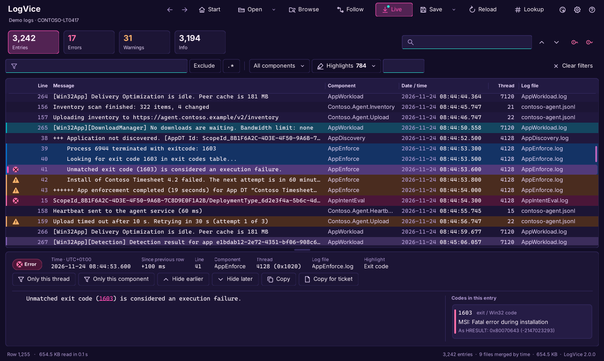
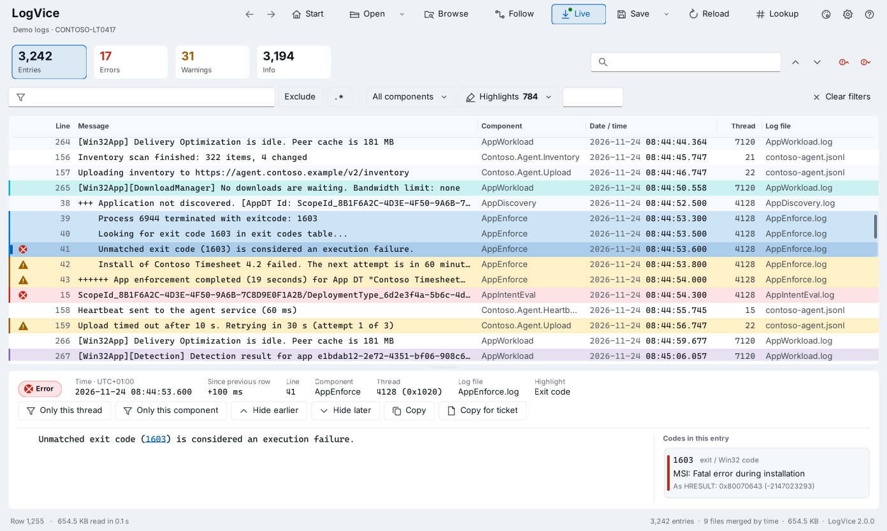
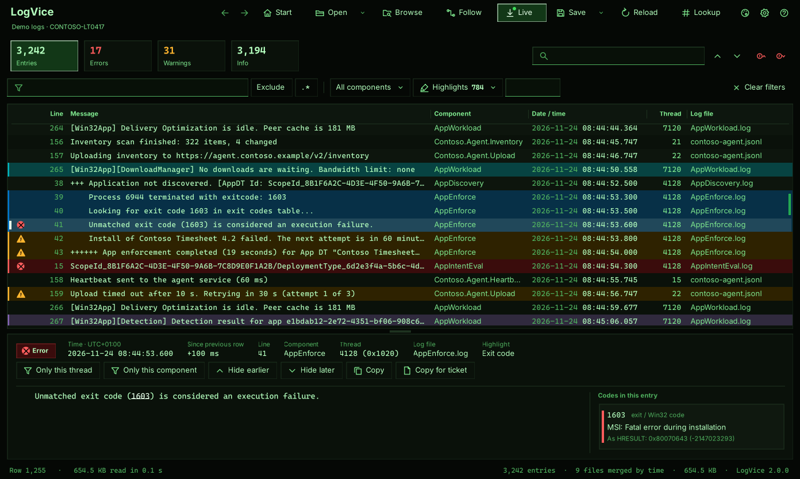

<p align="center">
  
</p>

<h1 align="center">LogVice</h1>

<p align="center">
  A fast CMTrace-style log viewer for ConfigMgr, Intune, Windows and JSON logs, and Windows event logs.
</p>

<p align="center">
  
  <a href="../../actions/workflows/build.yml"></a>
  
  
  
  <a href="LICENSE"></a>
</p>




LogVice is a log viewer for endpoint admins. It opens ConfigMgr and Intune logs the way CMTrace does, and also Windows logs, event logs and JSON Lines logs. It reads large files in the background, merges several logs into one timeline, follows them while they are written, and explains error codes. It is one small exe, read-only, and nothing leaves your computer. Free and open source under the MIT license.

<table>
  <tr>
    <td></td>
    <td></td>
  </tr>
  <tr>
    <td align="center">Light</td>
    <td align="center">Terminal</td>
  </tr>
</table>

There are six themes: Light, Dark, Vice, Terminal, Amber and Synthwave. LogVice is a companion to [TrackVice](https://github.com/Baldissera88/TrackVice) and [PolicyVice](https://github.com/Baldissera88/PolicyVice).

> LogVice was called Trace Lens up to version 1.3.2. The MSI upgrades an installed Trace Lens, and your settings come along.

**Full guide:** [docs/GUIDE.md](docs/GUIDE.md) explains every part of LogVice, one task at a time.

## Download and install

Get the latest version from [Releases](../../releases). Pick the package that suits you:

| Package | Use it when |
|---|---|
| `LogVice.msi` | You deploy to many devices with Intune or ConfigMgr. Installs per machine, adds a Start menu shortcut and *Open with* for `.log`, `.lo_`, `.etl` and `.evtx`, with an icon of its own for those files. It also makes `.logvice` session files open with LogVice |
| `LogVice.exe` | You want a portable tool on a USB stick, a share or a jump server. No install needed |
| `SHA256SUMS.txt` | Checksums of the exe and MSI, to check a download |

With winget, once the package is in the winget repository: `winget install DanielBaldissera.LogVice`.

The files are not code signed, so SmartScreen warns on the first start. Select **More info** and **Run anyway**.

Every release is built by [GitHub Actions](../../actions/workflows/build.yml) from the source in this repository, not on a private PC. Check that a file you downloaded is exactly what GitHub built:

```powershell
Get-FileHash .\LogVice.msi -Algorithm SHA256     # compare with SHA256SUMS.txt
gh attestation verify .\LogVice.msi -R Baldissera88/LogVice
```

## Quick start

1. **Open or drop a log.** Press Ctrl+O, or drop one or more files on the window. Several files are merged by time. No log at hand? Select **Start** and then **Look around** for made-up logs.
2. **Read the colours and counts.** Red rows are errors and yellow rows are warnings. The boxes at the top count entries, errors, warnings and information. Select one to show or hide those rows.
3. **Find and filter.** Ctrl+F finds text, F3 goes to the next match and F8 to the next error. Type in the filter box to show only rows that contain the text.
4. **Look up an error.** Select a row. A code in the message, such as 1603 or 0x87D00324, is a link, and the detail pane says what it means. Ctrl+L looks up any code.
5. **Save or copy for a ticket.** Ctrl+S saves what you have open, with the filters, as a session. Ctrl+Shift+C copies the selected rows as plain text for a ticket or an e-mail.

More in the [guide](docs/GUIDE.md): [Browse logs](docs/GUIDE.md#browse-logs), [Follow an item](docs/GUIDE.md#follow-an-item), [sessions](docs/GUIDE.md#saved-sessions-and-back-and-forward), [JSON Lines](docs/GUIDE.md#json-lines-logs), [Settings](docs/GUIDE.md#themes-and-settings) and the [command line](docs/GUIDE.md#open-logvice-from-scripts-trackvice-or-policyvice).

## What it reads

| Kind of log | Examples |
|---|---|
| CMTrace and SMS trace | ConfigMgr client and site server logs (`AppEnforce.log`, `CAS.log`, `smsts.log`), Intune Management Extension logs (`IntuneManagementExtension.log`, `AppWorkload.log`) |
| Windows servicing | CBS, DISM and Panther logs |
| Windows Update ETL | `WindowsUpdate.*.etl` traces |
| Windows event logs | Live channels (Application, System, Security, Intune MDM, Entra, Autopilot, Windows Update) on this computer or another one, and `.evtx` files |
| JSON Lines | One JSON object per line (`.jsonl`, `.ndjson`), or an array of objects (`.json`) |
| Plain text | Any text log with timestamps. UTF-8, UTF-16 and ANSI are detected |

Browse logs finds the usual folders for you, on this computer or another one:

| Group | Folders |
|---|---|
| ConfigMgr | Site server and management point logs, `SMS_<site code>` shares, distribution point logs, console, client `CCM\Logs`, `ccmsetup\Logs`, task sequence `SMSTSLog`, WSUS |
| Intune | `C:\ProgramData\Microsoft\IntuneManagementExtension\Logs` |
| Windows | `C:\Windows\Logs\WindowsUpdate`, `C:\Windows\Logs` (CBS, DISM), Panther, `$WINDOWS.~BT`, `debug`, `Temp` |
| Event logs | Common event log channels, and every channel that has events |

The [guide](docs/GUIDE.md#browse-logs) has the full list of folders.

## Requirements

- Windows 10, Windows 11 or Windows Server 2016 or later
- .NET Framework 4.8 or 4.8.1, which is part of every supported Windows version and supported for as long as Windows is. Nothing extra to install
- Windows Server 2016 with its built-in .NET Framework 4.6.2 also works

LogVice is compiled against the .NET Framework 4.5 API so the same exe runs on every .NET Framework 4.x a machine has. It does not need, or install, the retired 4.5 runtime.

## Updates and policies

Once a day at start, LogVice asks GitHub for its latest release. When it is newer, the status bar says so with **Install**. LogVice downloads the file, checks it against the release's checksums and installs it. Turn the check off under Settings > Updates, or for everyone with this policy value:

| Key | Value | Type | Data |
|---|---|---|---|
| `HKLM\SOFTWARE\Policies\LogVice` | `DisableUpdateCheck` | DWORD | `1` |

The administrative template is in [`policy/`](policy). For the MSI command lines and detection, see [Deploy with Intune or ConfigMgr](docs/GUIDE.md#deploy-with-intune-or-configmgr). In short:

| Setting | Value |
|---|---|
| Install command | `msiexec /i LogVice.msi /qn` |
| Uninstall command | `msiexec /x {34EAA767-3B0B-4EAD-825C-7DB0C33F69FC} /qn` |
| Detection | MSI product code `{34EAA767-3B0B-4EAD-825C-7DB0C33F69FC}` (version 2.0.0) |
| Upgrade code | `{2A8DF866-E6D4-4A44-ABAC-C64CA0D367B3}` (the same for every version) |

Each new version has a new product code, listed in the [changelog](CHANGELOG.md) and in the release notes.

## Privacy

LogVice reads your logs on your computer and sends nothing about you or them anywhere. Files are opened read-only with full sharing, so clients keep writing and rolling them. LogVice writes nothing else, except its settings in `HKEY_CURRENT_USER\Software\LogVice`, a temporary copy of an ETL file while it is read, the files of an update you choose to install, and the files you save, such as sessions.

The only internet calls LogVice makes are for updates: at most once a day it asks `api.github.com` for the latest release of this repository. **Report a problem** and **Suggest a feature** show exactly what goes along before anything leaves, and you send it yourself. More in the [guide](docs/GUIDE.md#privacy).

## Building

LogVice is plain C# 5 and Windows Forms, with no NuGet packages.

```powershell
.\build.ps1          # on Windows: LogVice.exe
.\build.ps1 -Msi     # also LogVice.msi, needs WiX Toolset 3
```

```sh
./build.sh           # on Linux or macOS with Mono: LogVice.exe
./package.sh         # LogVice.exe and LogVice.msi, needs msitools
./tests/run.sh       # the tests
```

The tests parse a set of small synthetic logs and compare the result with `tests/expected.txt`. After an intended change, refresh the file with `./tests/run.sh --update`. [docs/RELEASE.md](docs/RELEASE.md) describes how a release is made, and the [roadmap](ROADMAP.md) what comes next.

| Path | Contents |
|---|---|
| `src/Core.cs` | Log store, parsers for each format, loader and error code tables |
| `src/Logs.*.cs` | Readers for ETL, event logs and JSON Lines, log discovery and Follow an item |
| `src/Net.*.cs` | Connect as (SMB session) and the update check |
| `src/Session.cs`, `src/Ticket.cs` | Sessions with Back and Forward, and Copy for ticket |
| `src/Palettes.cs`, `src/Ui.*.cs` | The themes, the window, header, start page, log list, Settings and dialogs |
| `src/Demo.cs` | The made-up logs of Look around and `--demo` |
| `LogVice.wxs` | WiX source for the MSI |
| `tests/` | Synthetic sample logs and the test runner used by the build |
| `policy/` | Administrative template (ADMX) for Intune and Group Policy |
| `winget/` | Script that writes the winget manifests for a release |
| `art/` | Vector sources for `LogVice.ico` and `LogFile.ico`, and the script that renders them |
| `bump.sh`, `bump.ps1` | Set a new version, see [docs/RELEASE.md](docs/RELEASE.md) |

## Changelog

See [CHANGELOG.md](CHANGELOG.md) for every version.

## Contributing

Bug reports, log samples that do not parse well, and ideas are welcome in [Issues](../../issues). Remove computer names, user names and other private data from logs before you attach them. Pull requests are welcome too. Please keep to C# 5 and the .NET Framework 4.5 API level, so the same exe keeps running on the .NET Framework 4.6.2, 4.8 and 4.8.1 built into supported Windows versions.

## License

LogVice is released under the [MIT license](LICENSE). You may use, change and share it freely, also at work and for customers.

## Author

Developed by **Daniel L. Baldissera**.
