# LogVice guide

This guide explains LogVice one task at a time. It is written for a ConfigMgr or Intune admin who has not used LogVice before. For a quick start, see the [README](../README.md).

All logs, names and computers in the pictures are made up.

**Contents**

- [The window](#the-window)
- [Opening logs](#opening-logs)
- [Browse logs](#browse-logs)
- [Event logs and ETL traces](#event-logs-and-etl-traces)
- [Finding and filtering](#finding-and-filtering)
- [Error codes](#error-codes)
- [Follow an item](#follow-an-item)
- [Saved sessions and Back and Forward](#saved-sessions-and-back-and-forward)
- [Copy for ticket](#copy-for-ticket)
- [JSON Lines logs](#json-lines-logs)
- [Themes and Settings](#themes-and-settings)
- [Open LogVice from scripts, TrackVice or PolicyVice](#open-logvice-from-scripts-trackvice-or-policyvice)
- [Keyboard shortcuts](#keyboard-shortcuts)
- [Updates, policies and deployment](#updates-policies-and-deployment)
- [Privacy](#privacy)
- [Troubleshooting](#troubleshooting)

## The window

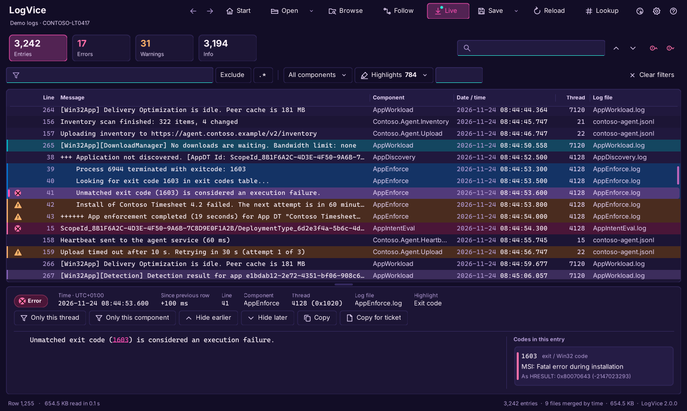

| Part | What it does |
|---|---|
| Header | The title, and under it what is open. Then the buttons: Back, Forward, Start, Open, Browse, Follow, Live, Save, Reload, Lookup, the theme button, Settings and Help. In a narrow window the less used buttons move into a **More** menu |
| Counts | Entries, errors, warnings and information. Select a box to show or hide those rows. **Entries** shows all rows again. The find box is on the same row, with buttons for the previous and next match and error |
| Filter row | The filter text, **Exclude**, the regex button, components, highlights, thread, any time limits and **Clear filters** |
| Log list | One row per entry: severity, line number, message, component, date and time, thread and log file. Error rows are red and warning rows are yellow. Drag a column edge to change its width |
| Detail pane | Under the list. It shows the selected row in full, and the error codes in it |
| Status bar | A message on the left. On the right the number of entries, the files, their size and the LogVice version. When a new version is out, a note with **Install** |

The **Live** button follows the open logs while they are written. It flashes when new lines arrive. **Reload** (F5) reads the files again.

The detail pane shows the time, the time since the previous row, the component, the thread (also in hex), the log file and the highlight rule. Its buttons filter by this thread or component, hide earlier or later rows, copy the row, and copy it for a ticket.

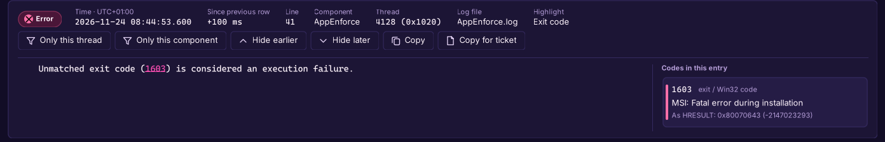

## Opening logs

1. Press Ctrl+O, or select **Open** and **Open files**. Pick one or more files.
2. LogVice reads them in the background. A progress line shows in the status bar. A 500 MB log opens without freezing the window.
3. With more than one file, LogVice merges the rows by time. The **Log file** column says which file each row came from.

Other ways to open logs:

- **Drag and drop.** Drop files on the window. Hold Ctrl while dropping to merge them into what is open. The window offers **Open** or **Merge in** when you drag over it.
- **Merge in.** Ctrl+Shift+O, or **Open > Merge in**, adds more files to what is open.
- **Rolled-over parts.** ConfigMgr and Windows roll logs over into `.lo_` files and dated copies. With **Auto-merge** on (Settings > Reading), LogVice adds those parts by itself: `.lo_`, dated copies, `CbsPersist_*` and `WindowsUpdate.*.etl`.
- **Recent.** **Open > Recent files** and the **Recent** list on the start page hold the logs and sessions you opened. Search the list, and pin an entry from its menu to keep it at the top.
- **Look around.** **Open > Look around** opens made-up ConfigMgr, Intune and agent logs of the laptop CONTOSO-LT0417. Nothing on your PC is read.
- **Wildcards.** From the command line, `LogVice.exe "C:\Windows\CCM\Logs\CcmExec*.lo*"` opens every match.

Files are opened read-only with full sharing, so clients keep writing and rolling them.

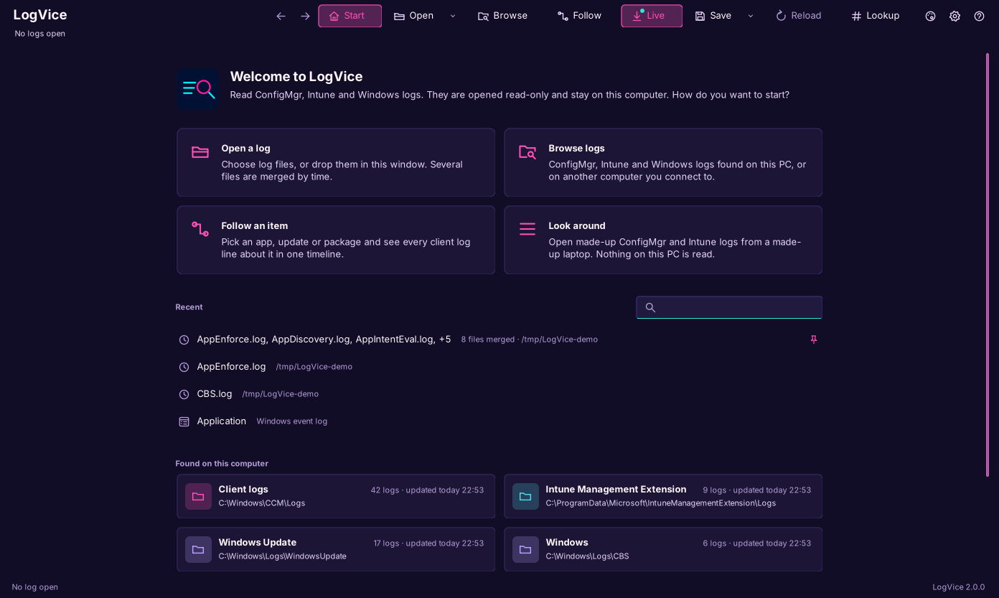

## Browse logs

Select **Browse** (Ctrl+B) to find logs without knowing where they are.

1. Pick a folder on the left. The files in it show on the right, newest first.
2. Select one file, or hold Ctrl or Shift to select several.
3. Select **Open**, or double-click a file. With a log already open, **Merge in** adds the files to it.

To browse another computer, type its name in the box at the top and select **Connect**. LogVice reads its admin shares. Select **Connect as** to use another account, so you need no Run as or second session. Browsing another computer needs an administrator account on it and SMB access.

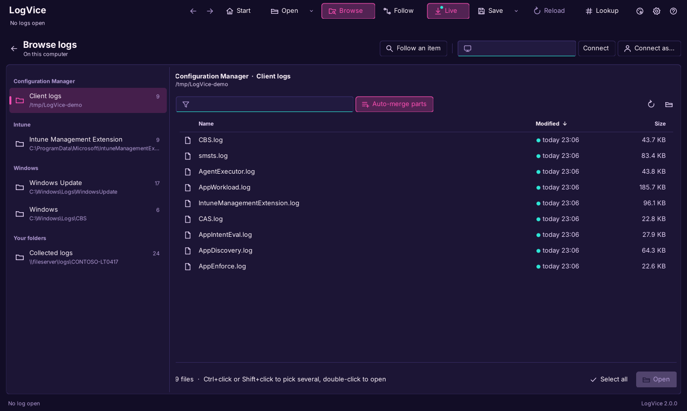

Browse logs looks in these places, on this computer and on other computers through the admin shares and the event log service:

Browse logs looks in these places, on this computer and, through the admin shares and the event log service, on other computers:

| Group | Folders |
|---|---|
| ConfigMgr | Site server and management point logs (from the registry or the default folder), `SMS_<site code>` shares, distribution point `SMS_DP$\sms\logs`, site setup, console `AdminUILog`, client `CCM\Logs`, `ccmsetup\Logs`, task sequence `SMSTSLog`, WSUS `LogFiles` |
| Intune | `C:\ProgramData\Microsoft\IntuneManagementExtension\Logs` |
| Windows | `C:\Windows\Logs\WindowsUpdate` (ETL), `SoftwareDistribution\ReportingEvents.log`, `C:\Windows\Logs` (CBS, DISM), Panther, `$WINDOWS.~BT`, `debug`, `Temp` |
| Event logs | Common event log channels, and every channel that has events |

Add your own folders, for example a share with collected logs, under Settings.

Add your own folders, for example a share with collected logs, under Settings > Folders.

## Event logs and ETL traces

In Browse logs, the **Event logs** group has two entries:

- **Common event logs**: Application, System, Security, Setup, Intune MDM, Entra (AAD), device registration, Autopilot, provisioning, Windows Update, BITS, Group Policy, BitLocker, Defender, AppLocker, Code Integrity, AppX deployment, PowerShell, Task Scheduler, WMI and WinRM.
- **All event logs**: every channel that has events.

Select one or more channels and open or merge them. Each event becomes one row:

| Column | Shows |
|---|---|
| Message | `[Event ID]` and the event text |
| Severity | Critical and Error as errors, Warning and audit failures as warnings |
| Component | The event provider |
| Thread | The thread ID of the event |
| Line | The record ID. Ctrl+G goes to a record |
| Source (detail pane) | Event ID and task category |

Live view follows channels on this computer. Reading another computer's event logs uses its event log service, so the firewall rule group *Remote Event Log Management* must be enabled there. Connect as works for event logs too.

**Windows Update ETL logs** (`WindowsUpdate.*.etl` in `C:\Windows\Logs\WindowsUpdate`) are decoded with the event information Windows has on this computer. Open several parts together to get the whole history. On Windows Server 2016 and Windows 10 1607 and earlier, run `Get-WindowsUpdateLog` instead, because those traces need Microsoft symbol files.

## Finding and filtering

| To do this | Do this |
|---|---|
| Find text | Ctrl+F, type. The match is marked in the rows. F3 or Enter goes to the next match, Shift+F3 to the previous one |
| Jump between errors | F8 and Shift+F8 |
| Show only rows with some text | Type in the filter box |
| Hide rows with some text | Type the text, then select **Exclude** |
| Use a regular expression | Select the `.*` button, then type the pattern |
| Show or hide a severity | Select the Errors, Warnings or Info box at the top. **Entries** shows all again |
| Show one component | Pick it in **All components**, or select **Only this component** in the detail pane |
| Show one thread | **Only this thread** in the detail pane, or type a thread number in the **Thread** box of the filter row |
| Limit by time | Select a row, then **Hide earlier** or **Hide later** in the detail pane. A time limit shows in the filter row. Select it to remove it |
| Go to a line | Ctrl+G |
| Remove every filter | **Clear filters** |

**Highlights** colour rows with your own rules. A rule has a label, a match (contains, or a regular expression) and a colour, for example *Detection*, *Download* or *Exit code*. Rows that match get the colour. The **Highlights** button in the filter row lists the rules: pick one to show only its rows. F7 and Shift+F7 jump between highlighted rows. Add, edit, order and remove rules under Settings > Highlights.

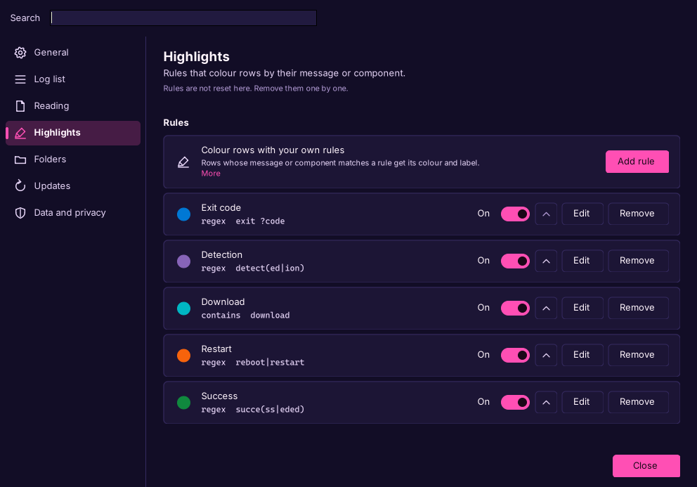

## Error codes

LogVice explains HRESULT, Win32, MSI, Windows Update and ConfigMgr codes.

1. Select a row. A code in the message, such as `1603` or `0x87D00324`, is a link.
2. The detail pane lists the codes in the row, with what each means and, for the common ones, what to do next. A code that is an exit code is also shown as an HRESULT.
3. Select the link to open **Error lookup** with that code.

**Lookup** (Ctrl+L) opens Error lookup for any code. Type a hex HRESULT (`0x87D00324`), a signed decimal as ConfigMgr prints it (`-2016410844`) or a Win32 or MSI exit code (`1603`). A code outside the built-in table is looked up in the Windows message tables on this computer.

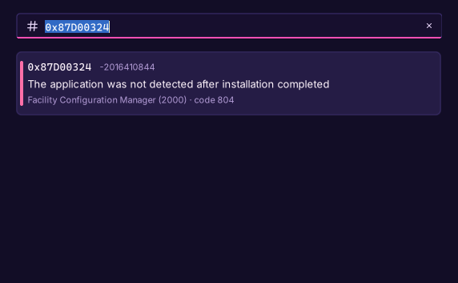

## Follow an item

Follow an item shows every log line about one app, update or package, from every client log, in one timeline.

Press **Ctrl+I**, or select **Follow** in the header, **Follow an item** on the start page or in Browse logs.

1. LogVice lists what it can follow:
    - from the ConfigMgr client's WMI: applications, software updates, packages and programs, and configuration baselines
    - from the client logs: deployment types, updates and programs
    - from the Intune Management Extension logs: Win32 apps with their MSI product code, Store apps with their package identifier, remediations with their last result and output, and platform scripts
    - from Apps & features: every installed app, with its MSI product code when it has one. An app that Intune deploys is shown once, on the Intune app.
2. Pick one, or hold Ctrl or Shift to pick several. LogVice collects their IDs, such as the application and deployment type IDs, the update ID and KB number, the package ID, the MSI product code or the Store package identifier.
3. It searches every log in `CCM\Logs`, `ccmsetup\Logs`, `SMSTSLog` and the Intune Management Extension logs, including rolled-over parts. Content IDs and download job IDs it finds on the way (CAS, ContentTransferManager, DataTransferService, BITS) are followed too.
4. With **Also search Windows events** on, it also looks through the newest 50,000 events in Application, System, the MDM diagnostics log, AppX deployment and Windows Update, for example the Windows Installer events for an MSI.
5. The logs and event logs with matches open merged by time, filtered to the lines about those items. Clear the filter to see everything around them.

**Also find lines that only mention the name** also matches the item's display name, which catches lines without an ID but can include other items with similar names.

The idea, and the description of how it could work, came from [u/overlydelicioustea](https://www.reddit.com/user/overlydelicioustea/) on r/SCCM. Thank you!

In Browse logs, Follow an item works on the computer you are connected to, through its admin shares and WMI. Reading the client's WMI and the installed apps on another computer needs the Windows Management Instrumentation firewall rules on it, and its Windows events need the Remote Event Log Management rules. Without WMI, LogVice lists what it finds in the logs.

Intune does not write the names of remediations and platform scripts to the device, so they are listed by their policy ID, the ID you also see in the Intune admin center.

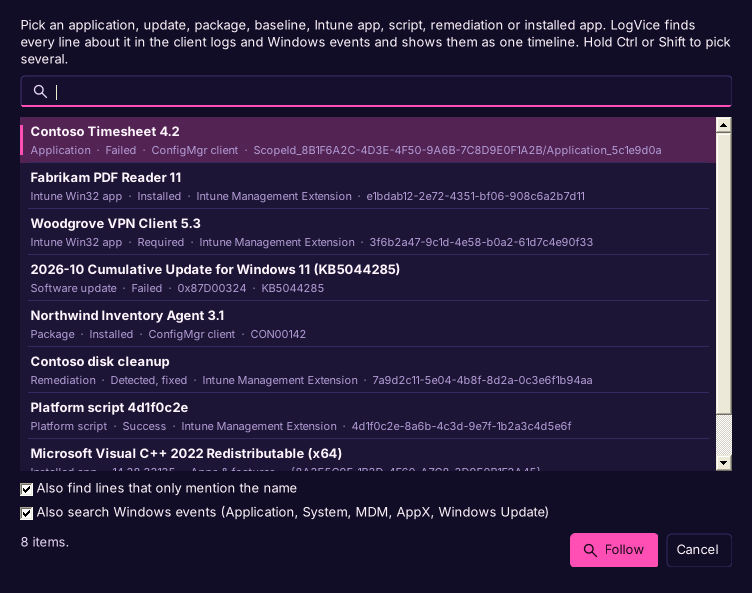

## Saved sessions and Back and Forward

A session is a `.logvice` file with the logs you have open, the filters, the search and the selected row.

1. Press Ctrl+S, or select **Save** and **Save session**. Choose a name.
2. To open it later, use **Open > Open session**, the **Recent** list, or double-click the file (the MSI makes `.logvice` files open with LogVice). You can also drop it on the window, or give it on the command line.

Logs that are missing are named in the status bar, and the rest open. Paths are saved as they are. A session holds no secrets, only the paths and the words you searched for. It is plain JSON, so a script can write one too.

**Back** and **Forward** (Alt+Left and Alt+Right, or the mouse buttons) go through the sets of logs you had open. Opening, merging, Browse logs, Follow an item, a session and Look around each add a step. Reload does not. LogVice keeps the last 30.

## Copy for ticket

Copy for ticket puts the rows you need on the clipboard as plain text, with the error codes explained.

1. Select one or more rows.
2. Press Ctrl+Shift+C, or use **Copy for ticket** in the row menu, in the detail pane or in the **Save** menu.
3. Paste it into the ticket or e-mail.

With one row selected, you also get the 5 rows before and after it, and the selected row is marked with `>`. At most 200 rows are copied. The text starts with the LogVice version, the computer, the logs and the filter, and ends with the error codes in the rows. For a JSON Lines row the line has the message only. **Save > Preview the text for a ticket** shows the text before you copy it.

```
LogVice 2.0.0 · CONTOSO-LT0417 · copied 2026-11-24 21:40 (UTC+01:00)
Logs: C:\Windows\CCM\Logs\AppEnforce.log, C:\Windows\CCM\Logs\AppDiscovery.log (merged by time)
Filter: errors and warnings · component AppEnforce

  2026-11-24 21:21:56.900  Info     AppEnforce  [1234]  Process 6944 terminated with exitcode: 1603
> 2026-11-24 21:21:57.123  Error    AppEnforce  [1234]  Unmatched exit code (1603) is considered an execution failure.

Error codes in these lines
1603 (0x00000643)  MSI: Fatal error during installation. Add /l*v to the msiexec command line ...
```

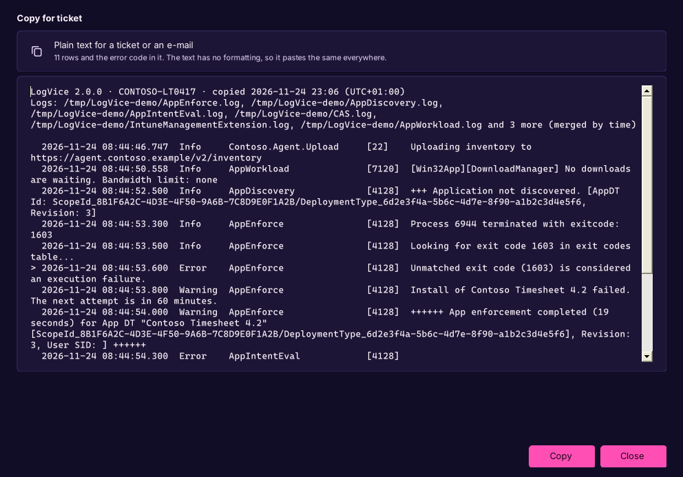

## JSON Lines logs

LogVice reads logs with one JSON object per line (JSON Lines, also called NDJSON), and files that are one array of objects. Use `.jsonl`, `.ndjson` or `.json`. LogVice looks at the first lines to see that it is JSON.

| Part | Names LogVice looks for (any case, the first one found is used) |
|---|---|
| Time | `@t`, `@timestamp`, `timestamp`, `time`, `ts`, `datetime`, `date`, `eventTime`, `TimeCreated`, `Timestamp` |
| Level | `@l`, `level`, `severity`, `lvl`, `loglevel`, `Level` |
| Message | `@m`, `message`, `msg`, `Message`, `text`, `@mt` (a template is filled in with the values of the object) |
| Component | `source`, `logger`, `component`, `category`, `SourceContext`, `module`, `app` |
| Thread | `thread`, `threadId`, `tid`, `ThreadId` |

- Levels error, err, fatal, critical, crit, alert, emerg and e are errors. Warn, warning and w are warnings. Anything else is information. Numbers follow syslog: 0 to 3 are errors, 4 is a warning. With no level, LogVice uses the same keyword rule as for other logs.
- Times in ISO 8601 with `Z` or an offset are shown in local time. A time without an offset is taken as local. A number is Unix seconds (10 digits) or milliseconds (13 digits).
- The list shows the message. The detail pane shows the message and then every other field as a `key: value` line. Filter and find search them too.
- A line that is not valid JSON stays in the list as plain text, so nothing is dropped.
- An array of 64 MB or more opens as plain text, with a note.
- JSON logs merge by time with the other logs.

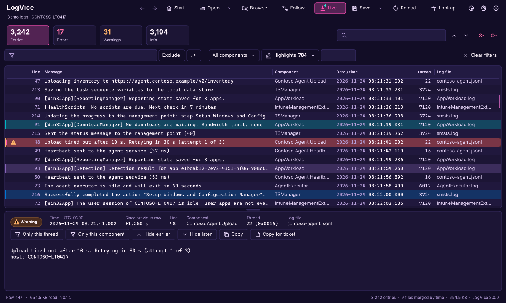

## Themes and Settings

There are six themes: **Light**, **Dark**, **Vice** (the default for new installs), **Terminal** (green on black), **Amber** and **Synthwave**. **System** follows the Windows app mode. If you used LogVice before 2.0, you keep the Light or Dark look you had. The theme button in the header cycles through the themes. With `--theme <name>` a theme is used for one run only.

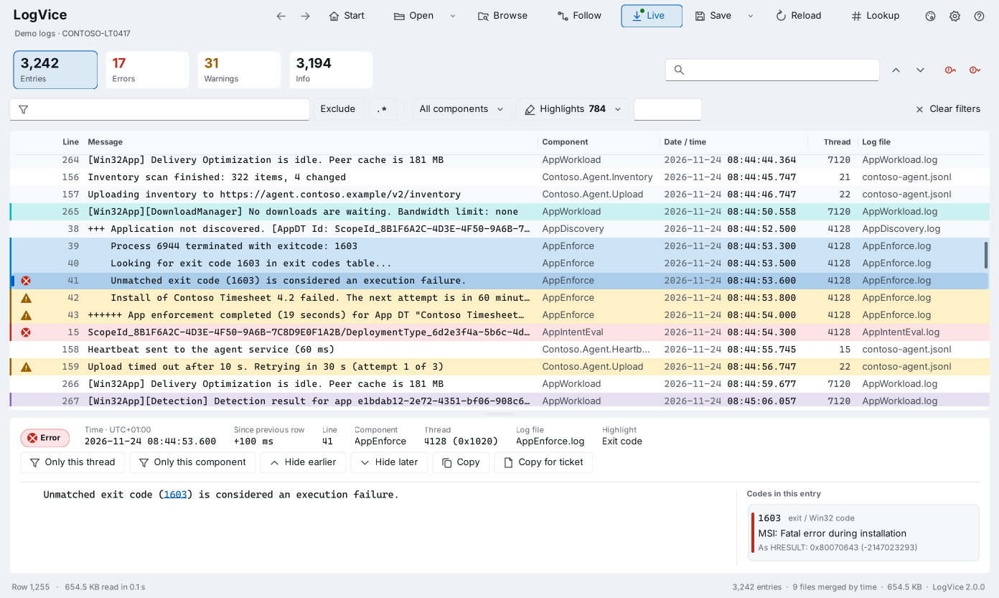

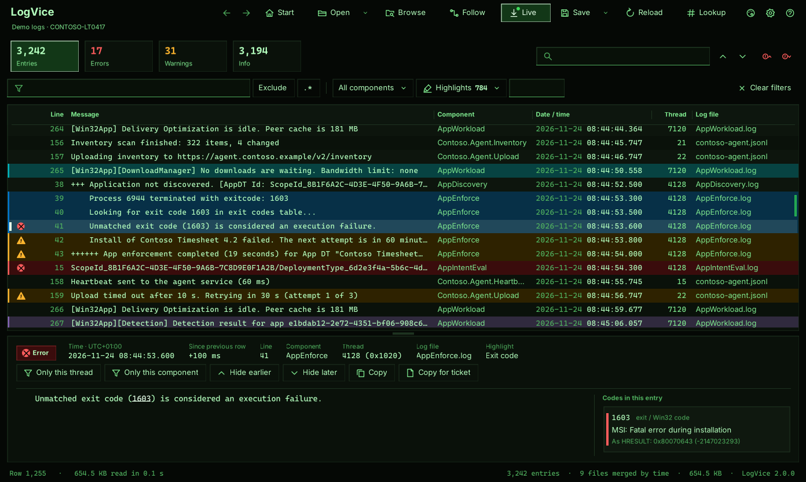

**Settings** (Ctrl+,) has a search over all settings, a mark on every setting you changed, and **Reset** on each page.

| Subject | What it holds |
|---|---|
| General | Theme, reopen the last logs at start, start with Live on |
| Log list | Log text size, row spacing, tinted error and warning rows, line numbers |
| Reading | Auto-merge of spanned logs, administrator rights (restart as administrator), default app for `.log` files |
| Highlights | The highlight rules: add, examples, on or off, order, edit, delete |
| Folders | The folders found on this computer, and your own folders |
| Updates | The update check, Check now, Install, the release page and What's new |
| Data and privacy | Clear recent files, where settings are kept, reset all settings, what LogVice writes |

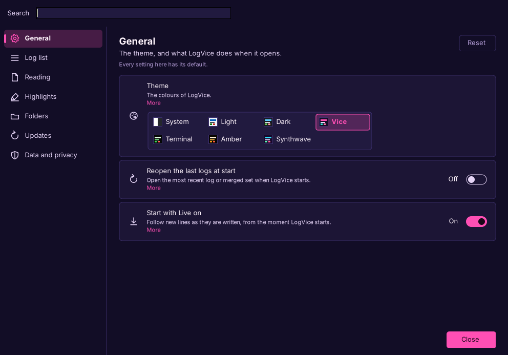

Settings are stored per user in `HKEY_CURRENT_USER\Software\LogVice`. Delete that key to reset everything. On first start, LogVice copies the settings from `HKEY_CURRENT_USER\Software\Trace Lens` if they are there.

LogVice runs as a normal user. When a log needs more, such as the Security event log, it offers to restart as administrator.

## Open LogVice from scripts, TrackVice or PolicyVice

```powershell
# Open one log
LogVice.exe C:\Windows\CCM\Logs\AppEnforce.log

# Open several logs merged by time
LogVice.exe C:\Windows\CCM\Logs\AppDiscovery.log C:\Windows\CCM\Logs\AppEnforce.log

# Wildcards and remote computers work too
LogVice.exe \\PC0123\C$\Windows\CCM\Logs\CcmExec*.lo*

# Event logs: an exported file, a channel here, or a channel on another computer
LogVice.exe C:\Temp\System.evtx
LogVice.exe evt:Application "evt:Microsoft-Windows-DeviceManagement-Enterprise-Diagnostics-Provider/Admin"
LogVice.exe evt:\\PC0123\System

# Merge a log file with an event log
LogVice.exe C:\ProgramData\Microsoft\IntuneManagementExtension\Logs\IntuneManagementExtension.log "evt:Microsoft-Windows-DeviceManagement-Enterprise-Diagnostics-Provider/Admin"

# A saved session
LogVice.exe C:\Temp\CONTOSO-LT0417.logvice
```

| Option | What it does |
|---|---|
| `--line <n>` | Selects line n of the first file. If the line has no entry of its own, the next entry is selected |
| `--time "yyyy-MM-dd HH:mm:ss[.fff]"` | Selects the first row at or after this time |
| `--find <text>` | Searches for the text, starting from the selected row. Use `--line` or `--time` to choose the row first |
| `--filter <text>` | Only shows rows that contain the text |
| `--errors` | Only shows errors and warnings |
| `--theme <name>` | Uses this theme for this run only: Light, Dark, Vice, Terminal, Amber, Synthwave or System |
| `--demo` | Opens made-up ConfigMgr, Intune and agent logs of CONTOSO-LT0417, merged by time. Nothing on this PC is read |

The options work with files, event logs and sessions, alone or together. LogVice ignores an option it does not know and says so in the status bar. **Help > Command line** lists them all. Another tool can call LogVice the same way. This opens the Intune app log at the time of an installation and searches for the app:

```powershell
LogVice.exe "C:\ProgramData\Microsoft\IntuneManagementExtension\Logs\AppWorkload.log" --time "2026-11-24 21:21:57" --find "Contoso Timesheet" --theme vice
```

For screenshots, `--shot <file.png>` with `--size WxH` saves a picture of the window and exits, and `--page <name>` shows a page instead, such as `welcome`, `browse`, `follow`, `lookup`, `settings`, `about`, `update`, `feedback` or `ticket`. A run with `--shot` saves no settings and makes no update check.

## Keyboard shortcuts

| Keys | Action |
|---|---|
| Alt+Home | Start page |
| Ctrl+O | Open log files |
| Ctrl+Shift+O | Merge in more log files, interleaved by time |
| Alt+Left / Alt+Right | Back and Forward through the logs you had open. The mouse back and forward buttons do the same |
| Ctrl+S | Save the open logs and filters as a session (`.logvice` file) |
| Ctrl+Shift+C | Copy the selected rows for a ticket |
| Ctrl+B | Browse logs on this computer or another one. Press it again to go back |
| Ctrl+I | Follow an item through every client log |
| F5 | Read the open files again |
| Ctrl+L | Error lookup |
| Ctrl+F | Find |
| Enter / Shift+Enter | In the find box: next / previous match |
| F3 / Shift+F3 | Next / previous match |
| F8 / Shift+F8 | Next / previous error |
| F7 / Shift+F7 | Next / previous highlighted row |
| Ctrl+G | Go to a line of the log file |
| Up, Down, PgUp, PgDn, Home, End | Move through the rows. Hold Shift to select several |
| Ctrl+C | Copy the selected rows |
| Ctrl+A | Select all rows |
| Ctrl+, | Settings |
| F1 | The Help menu |
| Esc | Clear the find box, leave the start page, or go back from Settings or Browse logs |

## Updates, policies and deployment

### Updates

Once a day at start, LogVice asks GitHub (`api.github.com`) for its latest release. When it is newer, the status bar says so with **Install**.

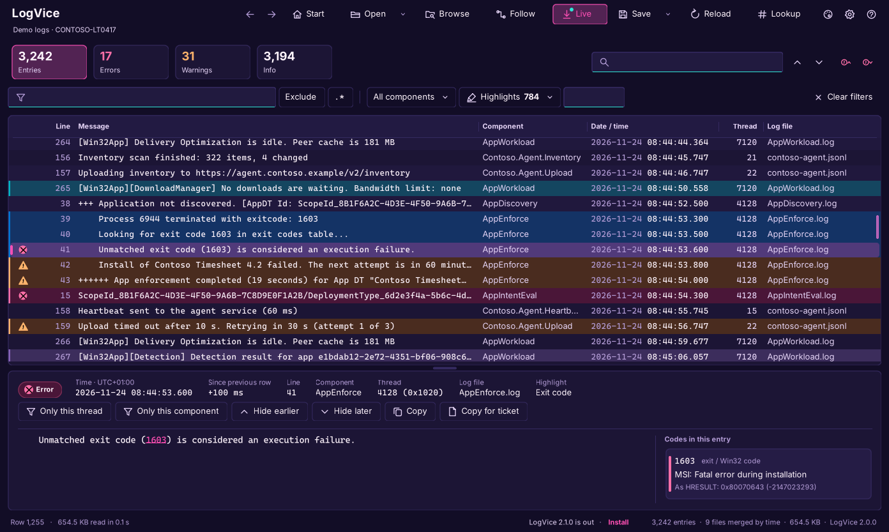

1. Select **Install** in the status bar, or **Install** in Settings > Updates.
2. LogVice downloads `SHA256SUMS.txt` and the MSI (or the exe, for a copy run from a folder) from that release on `github.com`.
3. It runs the file only if its SHA-256 checksum matches. A small **Updating LogVice** window shows each step, and LogVice opens again with your logs.
4. **What's new** shows what changed.

**Settings > Updates** turns the check on or off and has **Check now**. Both calls use the Windows proxy settings. Pre-releases are not offered. There is no check, and no install, when LogVice runs as SYSTEM, in Windows PE, during Windows setup or the Autopilot enrollment status page, while a task sequence runs, or with `--shot`.

### Deploy with Intune or ConfigMgr

The MSI installs per machine, needs no restart and upgrades any earlier version in place, Trace Lens included.

| Setting | Value |
|---|---|
| Install command | `msiexec /i LogVice.msi /qn` |
| Uninstall command | `msiexec /x {34EAA767-3B0B-4EAD-825C-7DB0C33F69FC} /qn` |
| Detection | MSI product code `{34EAA767-3B0B-4EAD-825C-7DB0C33F69FC}` (version 2.0.0) |
| Upgrade code | `{2A8DF866-E6D4-4A44-ABAC-C64CA0D367B3}` (the same for every version) |
| Install context | System |

Each new version has a new product code, listed in the [changelog](../CHANGELOG.md) and in the release notes. Add it as a new app that supersedes the earlier one.

On managed devices, users without administrator rights cannot install the MSI from the **Install** note in the status bar, so deploy new versions with Intune or ConfigMgr and turn off the update check. Use the administrative template in [`policy/`](../policy): import `LogVice.admx` and `en-US/LogVice.adml` in Intune under **Devices > Configuration > Import ADMX**, or copy them to the Group Policy central store, then enable **LogVice > Turn off the update check**. This also hides the update note. The policy sets this value:

| Key | Value | Type | Data |
|---|---|---|---|
| `HKLM\SOFTWARE\Policies\LogVice` | `DisableUpdateCheck` | DWORD | `1` |

To check a download, see [Download and install](../README.md#download-and-install) in the README.

## Privacy

LogVice reads your logs on your computer and sends nothing about you or them anywhere. Files are opened read-only. LogVice writes nothing else, except its settings, a temporary copy of an ETL file while it is read, the files of an update you choose to install, and the files you save, such as sessions.

The only internet calls LogVice makes are for updates. At most once a day it asks `api.github.com` for the latest release of this repository, and it sends nothing else. When you select **Install**, it downloads from `github.com`, and runs the file only if its SHA-256 checksum matches. Turn it off under Settings > Updates or with the policy above.

**Help > Report a problem** and **Help > Suggest a feature** show exactly what goes along before anything leaves: the LogVice, Windows and .NET versions, the theme, and the formats of the open logs. Paths, file names and log text are never added unless you type them. They open a [GitHub issue](https://github.com/Baldissera88/LogVice/issues) with the text filled in, or an e-mail to the author, or copy the text. You send it yourself.

## Troubleshooting

| Problem | What to do |
|---|---|
| A log does not open | Check that the file still exists and that you can read it. Another program may have it open with no sharing. LogVice opens files with full sharing, but cannot open a file that is locked exclusively. Try Reload (F5) |
| The rows are not parsed, or all in one line | The format is not known. Open a few lines in Notepad and send a sample with the names changed, with Help > Report a problem |
| A log needs administrator rights | LogVice offers to restart as administrator. You can also turn it on under Settings > Reading. The Security event log and some protected folders need it |
| Browse logs says access is denied | You need an administrator account on the other computer and SMB access. Use **Connect as** with that account. Local accounts other than the built-in Administrator are blocked over the network by Remote UAC |
| Event logs of another computer are empty | Enable the firewall rule group *Remote Event Log Management* on it |
| Follow an item finds no apps on another computer | Reading the client's WMI and the installed apps on another computer needs the Windows Management Instrumentation firewall rules on it. Without WMI, LogVice lists what it finds in the logs |
| SmartScreen warns on the first start | The exe and MSI are unsigned. Select **More info** and **Run anyway**. Check the download with `SHA256SUMS.txt` first. AppLocker and WDAC need the files signed with your own certificate |
| The update does not install | Users without administrator rights cannot install the MSI. Deploy the new version with Intune or ConfigMgr and turn off the update check |
| The order of rows looks wrong | Merging sorts by the local time in each log, so logs from different time zones can interleave out of order |

### Known limitations

- The exe and MSI are unsigned. SmartScreen warns on downloaded copies, and AppLocker or WDAC need them signed with your own certificate.
- Windows Update traces from Windows Server 2016 and Windows 10 1607 and earlier need Microsoft symbol files. Run `Get-WindowsUpdateLog` for those.
- Browsing another computer needs an administrator account on it and SMB access. Local accounts other than the built-in Administrator are blocked over the network by Remote UAC.
- Event log channels on another computer are not followed live. Press F5 to read new events.
- An `.evtx` file from another computer is shown with the event texts installed on this computer. Events from a provider that is not installed here show their values instead of the full text.
- Merging sorts by the local time in each log, so logs from different time zones can interleave out of order.
- Logs are held in memory, about two to three times their size on disk.
